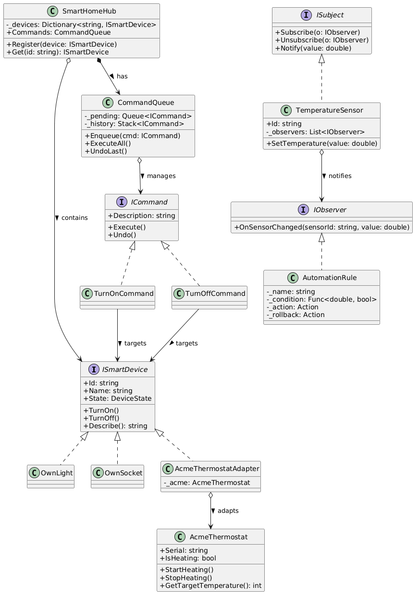

# Variante 3 - Умный дом (Maison Intelligente)

Консольное приложение на C# (.NET), демонстрирующее работу паттернов проектирования **Adapter**, **Command** и **Observer** на примере системы «Умный дом».

## 🎯 Постановка задачи
Пульт управления умным домом: лампы, розетки, датчики температуры, кондиционеры. Устройства разных производителей имеют несовместимые интерфейсы. Нужно включать/выключать устройства по расписанию и по событию от датчиков (например, «температура выше 26 — включить кондиционер»).

## 🏗️ Архитектура и паттерны

В проекте использованы 3 паттерна:

1. **Adapter (Адаптер)**
   * **Проблема:** Устройство стороннего производителя (`AcmeThermostat`) имеет несовместимый интерфейс (`StartHeating()`, `StopHeating()`).
   * **Решение:** Класс `AcmeThermostatAdapter` реализует общий интерфейс `ISmartDevice` и делегирует вызовы к API ACME.

2. **Command (Команда)**
   * **Проблема:** Действия пользователя (включить/выключить) нужно ставить в очередь и выполнять отложенно, а также иметь возможность отмены (Undo).
   * **Решение:** Каждое действие инкапсулировано в класс, реализующий `ICommand` (`TurnOnCommand`, `TurnOffCommand`). `CommandQueue` хранит команды и ведет историю.

3. **Observer (Наблюдатель)**
   * **Проблема:** Датчик температуры не должен знать, кто на него подписан.
   * **Решение:** `TemperatureSensor` реализует `ISubject`, а правила автоматизации (`AutomationRule`) реализуют `IObserver`.

## 🚀 Инструкция запуска

1. Установите [.NET SDK](https://dotnet.microsoft.com/download).
2. Перейдите в папку проекта:
   ```bash
   cd SmartHome
## 📊 Диаграмма классов


